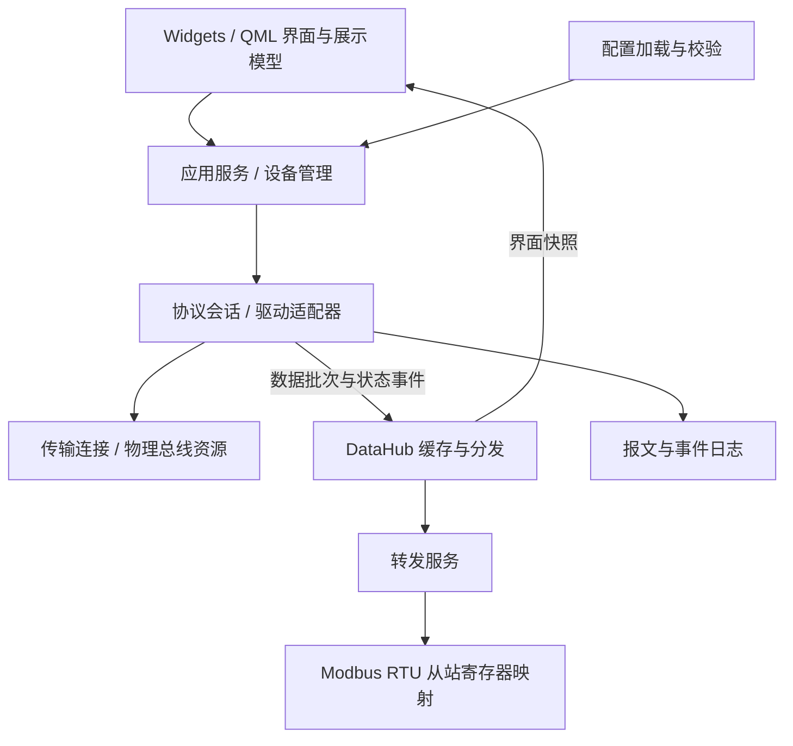
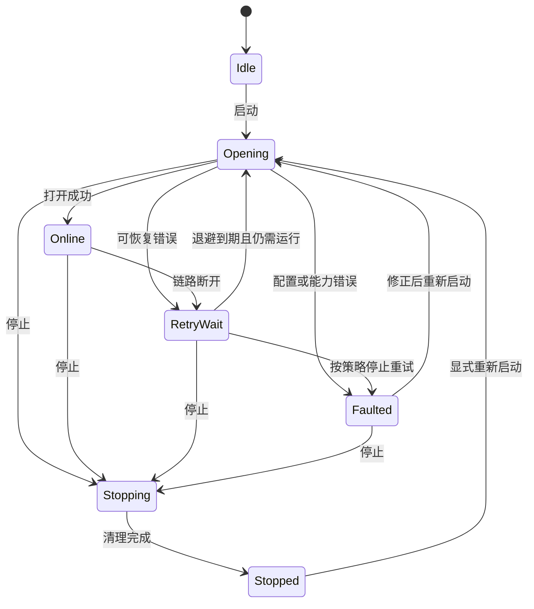
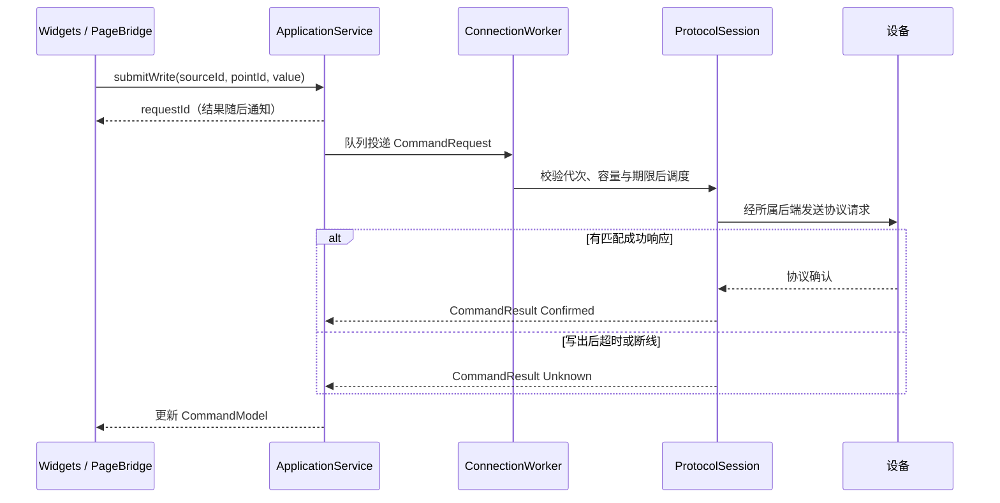

# 多协议工业数据采集与监控平台

> 设计与实现记录 · v1.3 首个模拟运行里程碑 · 2026-10-07
>
> 状态：已开始核心骨架实现，当前程序版本 v0.2.0；真实设备协议尚未接入。第 11.1 节记录当前已实现范围，其余章节仍包含后续设计草案。
> 作者定位：嵌入式软件工程师，单人开发与维护。
> 来源：作者提供的 v1.0 设计思路。

本文作为唯一的设计文档，集中维护需求、架构、接口、实施规划与待决策问题。标为“整理建议”的内容是供研究的补充，并不代表已经采纳；示例接口、配置和目录为设计草案，实现状态以第 11.1 节为准。后续讨论直接在本文修改，暂不拆分专题文档。

## 阅读导航

1. [项目定位与边界](#1-项目定位与边界)
2. [需求与验收口径](#2-需求与验收口径)
3. [技术选型](#3-技术选型)
4. [整体架构与职责](#4-整体架构与职责)
5. [数据模型与接口](#5-数据模型与接口)
6. [并发与生命周期](#6-并发与生命周期)
7. [协议与功能模块](#7-协议与功能模块)
8. [配置设计](#8-配置设计)
9. [界面与数据流](#9-界面与数据流)
10. [工程组织与发布](#10-工程组织与发布)
11. [实施路线与验证](#11-实施路线与验证)
12. [风险与技能积累](#12-风险与技能积累)
13. [决策记录与待澄清事项](#13-决策记录与待澄清事项)
14. [修订记录与参考](#14-修订记录与参考)

本轮重点阅读：4.3 类职责与对象关系 → 5.2 接口契约 → 6.3～6.5 生命周期与状态 → 8 配置结构 → 9.1.2 页面接口。新增设计采用可供后续编码的默认方案，但不将尚未讨论的产品取舍标记为作者已确认。

## 1. 项目定位与边界

### 1.1 背景

项目起点是一个类似 Modbus Poll 的调试工具，希望提供更清晰、现代、容易定制的界面。长期方向扩展为支持 Modbus TCP/RTU、原始串口通信和数据转发的通用采集与监控平台。

首先服务作者自身的嵌入式设备调试与监控工作，后续再面向工业现场工程师和测试人员。项目同时承担 C++/Qt 工程能力训练，但功能设计以真实使用场景为依据。

### 1.2 核心目标

| 目标 | 具体含义 |
| --- | --- |
| 多协议 | 支持不同设备接入，核心与界面尽量不随协议变化 |
| 清晰的交互 | 连接、数据、异常、写入结果可直观区分 |
| 配置驱动 | 通过 JSON 配置设备、点位和转发规则 |
| 单人可维护 | 每个阶段都可运行，按需求引入抽象 |
| 工程能力积累 | 掌握异步通信、对象生命周期、模型视图、测试与发布 |

### 1.3 范围划分

**当前方向**：多设备、多协议、表格与趋势图、报文日志；首版以 Modbus 为主，同时考虑自定义协议扩展。转发首先面向 Modbus RTU 从站。界面采用 Widgets + QML 原生桌面方案，QML 用于多个界面的加载与热更新；当前不做 Web 界面，不引入 WebView/WebEngine。

**已确认（D01、D02）**：首版包含读取和写入，以完整 Modbus 能力为目标，不再把写入推迟到下一版本。“完整”的功能码、传输方式和客户端/服务端角色覆盖需要列出清单；不会默认为 Qt 默认接口已覆盖全部需求。开发内部可以逐步完成读取、写入和其他功能，但首版交付边界以该清单为准。

Windows 为首个交付平台。Linux/macOS 是兼容方向，现有 Windows 工具链与打包配置不能视为已具备跨平台交付能力。

## 2. 需求与验收口径

### 2.1 功能需求

| 编号 | 功能 | 原优先级 | 建议验收关注点 |
| --- | --- | --- | --- |
| F1 | Modbus TCP 客户端读写 | 高 | 读取正确；写入结果可追踪；断线与异常响应可见 |
| F2 | Modbus RTU 客户端读写 | 高 | 串口参数正确；同总线多站点有序访问 |
| F3 | 原始串口收发 | 高 | 字节准确；支持 HEX/文本；连续接收有容量限制 |
| F4 | 采集数据映射到 Modbus RTU 从站 | 中 | 外部主站可读取映射值；异常与过期数据策略明确 |
| F5 | 多设备并发 | 高 | 故障设备不会拖住其他设备或 UI |
| F6 | JSON 配置设备与数据源 | 高 | 错误字段定位明确；重复 ID 能被拒绝 |
| F7 | 表格、仪表、趋势图 | 高 | 值、单位、时间、质量可区分；显示量受控 |
| F8 | 报文监控与日志 | 中 | 可定位来源、方向和错误；文件可轮转 |
| F9 | QML 多界面加载与热更新；后续低代码设计器 | 热更新已确认；设计器后续 | 重载界面不重启采集，加载失败可恢复 |

完整 Modbus 是作者确认的首版目标；需将其细化为功能覆盖矩阵，避免只实现常用读写后就标记完成。自定义协议沿传输与协议分层接口扩展。

### 2.2 非功能需求

| 项目 | 原方案目标 | 需要明确的验收条件 |
| --- | --- | --- |
| 轮询 | 暂不设 50 ms 指标（D03） | 保留可配置轮询与超时；现阶段不设置数值性能门槛 |
| 并发 | 架构支持多个设备（D04） | 暂不设 20 设备基准或容量压测任务 |
| 稳定性 | 7×24 小时运行、自动重连 | 连续运行时长、内存增长、断线注入、队列上限与恢复情况 |
| 扩展 | 新协议实现统一接口 | 注册驱动通常仍需工厂和构建配置变更；动态插件另行设计 |
| 可维护性 | 模块清晰、文档和规范统一 | 核心可独立测试，协议依赖不泄漏到 UI |
| 平台 | Windows 优先，兼顾其他平台 | 按平台分别验证构建、驱动、串口权限与安装包 |

**已按 D03、D04 暂缓数值指标**：当前只保留多设备设计、异步交互和必要的轮询/超时配置。50 ms 与 20 台容量测试不作为本阶段前置任务，后续有实际设备负载再制定目标。

## 3. 技术选型

### 3.1 当前方向

采用 Qt 6 + C++，Widgets 与 QML 明确分工：Widgets 承担主框架和桌面工具面板，QML 承担可切换、可热更新的多个界面，C++ 提供共享业务与数据模型。不做 Web。仓库沿用 C++20、CMake、Ninja、LLVM-MinGW Clang、clangd 和 Python 开发脚本。

选择理由是已有 C/C++ 基础、Qt 的通信与桌面组件适合需求。QML 的主要目的已明确为界面热更新，而不只是动画或美化；界面包重载与设备配置重连是两个独立流程。

### 3.2 候选方案回顾

下表记录本项目取舍，不是各框架性能或就业价值的普遍排名。

| 方案 | 本项目可能收益 | 本项目主要代价 | 当前结论 |
| --- | --- | --- | --- |
| Tauri + Web | Web UI 灵活 | 引入 Rust 与前端学习、维护成本 | 暂不采用 |
| Qt WebView + C++ | 可复用 Web 页面 | 桥接、平台能力和版本支持需要验证 | 暂不采用 |
| Qt WebEngine + C++ | Web 展示与交互能力丰富 | 部署依赖和资源成本增加 | 暂不采用 |
| Python + PySide6 | 原型迭代方便 | 不符合本项目以 C++ 为核心的学习目标 | 业务应用暂不采用；开发脚本保留 Python |
| Qt Widgets/QML + C++ | 桌面工具与可更新界面结合 | 需要设计 C++ 接口、页面生命周期与版本兼容 | 已采用混合方向 |

原稿中“打包体积极小”“Python 性能天花板”“行业收益极强”等判断没有本项目实测或调研支持，本整理稿不将其作为结论。选型可以用最小原型和真实负载重新验证。

### 3.3 模块与依赖规划

| 能力 | 候选 Qt 模块 / 类 | 引入时机 |
| --- | --- | --- |
| 基础界面与 JSON | Core、Widgets、QJsonDocument | 现有基础 |
| Modbus TCP/RTU | SerialBus、QModbusTcpClient、QModbusRtuSerialClient | 对应协议阶段 |
| 原始串口 | SerialPort、QSerialPort | 串口阶段 |
| RTU 从站转发 | SerialBus、QModbusRtuSerialServer | 首个转发方向 |
| TCP/MQTT 转发 | Network / Mqtt | 当前不优先，后续有需求再评估 |
| 趋势图 | 原稿候选 Qt Charts | 图表阶段比较性能与依赖后确认 |
| 多界面与热更新 | Qml、Quick、QuickWidgets，按需 QuickControls2 | 界面架构设计阶段纳入 |

Qt 6.8 的 RTU 客户端类采用 `QModbusRtuSerialClient`，原稿中的 `QModbusRtuSerialMaster` 名称应按当前 API 调整。[官方类文档](https://doc.qt.io/qt-6.8/qmodbusrtuserialclient.html)

## 4. 整体架构与职责

### 4.1 方案演进

原方案的分层方向保留；根据 D05，DataHub 改为入口创建并注入。D06 已明确要求同一个 CAN 口可承载 Modbus 相关封装与自定义协议，物理连接和协议分层组合，线程划分不与逻辑层数绑定。D09 已采纳转发职责独立、协议代码复用。

### 4.2 当前职责划分



箭头表达逻辑依赖或数据方向，不代表可以直接跨线程调用成员函数。

| 模块 | 负责 | 边界 |
| --- | --- | --- |
| 应用入口 | 组装对象、启动与退出 | 不放协议解析 |
| 设备管理 | 配置、驱动创建、会话生命周期 | 不直接绘制界面 |
| ProtocolSession | 请求、响应、协议错误、状态事件 | 不持有 QWidget；统一替代前稿的 ProtocolDriver 命名 |
| DataHub | 最新值、质量状态、订阅分发 | 不包办所有网络连接与文件操作 |
| 转发服务 | 订阅、转换、队列、目标连接 | 不混同采集驱动的读写语义 |
| UI 模型 | 展示、编辑校验、交互状态 | 不直接访问工作线程对象 |
| 配置与日志 | 配置持久化、诊断记录 | 不阻塞采集热路径 |

**已确认（D05、D09）**：DataHub 由入口创建并注入；转发业务单独组织，复用协议编解码和连接基础设施。**建议（D07）**：写命令进入应用服务，DataHub 管理数据。D07 作者接受两种入口，本稿暂用应用服务表达流程，不视为作者已排除另一方案。扩展先考虑工厂注册，动态插件不是当前前提。

### 4.3 类职责与对象关系（详细设计草案）

先固定“谁负责什么”，再确定头文件和实现细节。以下名称作为本稿统一术语；一个职责不一定立刻对应一个独立库。

| 类 / 组件 | 主要职责与持有状态 | 归属与边界 |
| --- | --- | --- |
| AppRuntime | 在 main 中组装依赖，协调全局启动、配置应用和退出 | 主线程；拥有应用级服务，不解析协议 |
| ConfigRepository | 读取、校验和保存配置，生成不可变的 ConfigSnapshot | 无通信资源；文件读写可交后台任务 |
| RuntimeManager | connection/session/source 注册表、资源占用、配置代次、工作线程生命周期 | 主线程；持有工作对象句柄，不直接读取其可变状态 |
| ApplicationService | UI/转发写回的统一命令入口，校验、路由、限流、请求结果记录 | 主线程；不把命令受理解释为设备成功 |
| ConnectionWorker | 一个连接的运行容器，统一启停、重连、收发调度和会话管理 | 连接 I/O 线程；采集端拥有后端及会话，输出端拥有服务端 Endpoint |
| ConnectionBackend | 封装实际 CAN、串口、TCP 或 Qt Modbus 资源 | 与 Worker 同线程；按后端能力提供帧流或事务接口 |
| ProtocolSession | 具体协议在当前连接上的实例，维护源设备、轮询、分包和请求关联 | 与 Worker 同线程；每个实例独立可变状态 |
| ProtocolFactory / Codec | 按 protocolType 创建实例；编解码及协议能力描述 | 工厂注册初期静态完成；纯逻辑可复用，无全局会话状态 |
| DataHub | 点位最新值、质量、过期处理及变更批次 | 初期主线程；不拥有连接，不发送设备命令 |
| ForwardingService / RegisterMapper | 将点位快照映射为寄存器更新，处理映射规则 | 初期主线程；不直接操作工作线程中的服务端 |
| ModbusServerEndpoint | 持有 RTU 服务端及寄存器镜像，处理外部主站请求 | 输出连接 I/O 线程；与采集 Session 分开角色 |
| PointTableModel / DeviceTreeModel / CommandModel | 分别展示点位、连接/源状态及命令结果 | 主线程；通过服务获取数据，不保存通信对象 |
| PageManager / PageBridge | 管理 QML 页面实例、订阅、接口版本与命令入口 | 主线程；页面消失不停止采集 |

RawFrame 缓冲、有限趋势和日志写盘按第 6.2、7.4 节组织，避免都塞入 DataHub。小型校验器、映射器先使用普通 C++ 类或函数；有事件、定时器、线程归属需要时再使用 QObject。

```text
main / AppRuntime（主线程）
  ├─ ConfigRepository、RuntimeManager、ApplicationService、DataHub
  ├─ ForwardingService、UI Models、MainWindow / PageManager
  └─ RuntimeManager 管理 QThread 句柄与以下 Worker 的生命周期
       I/O 线程 1：ConnectionWorker CAN1
         ├─ CanBackend（唯一接收者、发送调度）
         ├─ Session A1 → Source 现场设备 1
         └─ Session B1 → Source 现场设备 2
       I/O 线程 2：ConnectionWorker CAN2
         ├─ CanBackend
         └─ Session A2 → Source 现场设备 3
```

上图的跨线程“管理”不是 QObject 父子关系。Worker 在工作线程管理子对象；RuntimeManager 通过队列命令管理 Worker。QThread 对象本身留在创建它的主线程，业务槽放在 Worker 中。[Qt QThread 文档](https://doc.qt.io/qt-6.8/qthread.html)

### 4.4 连接后端与协议适配

统一的是生命周期、标识和路由；不要强迫所有后端都提供相同的裸字节接口。

| 后端类型 | 资源拥有者与调度 | 协议侧使用方式 |
| --- | --- | --- |
| CAN 帧后端 | CanBackend 独占 QCanBusDevice；分发器与发送队列属于当前 Worker | 多个 CAN Session 接收匹配帧，提交待发送帧 |
| 原始串口 / 自定义 TCP | SerialBackend / TcpBackend 独占相应 Qt 通信对象 | Session 负责字节流分帧；未定义复用规则时独占连接 |
| Qt Modbus 客户端 | QtModbusBackend 内部持有一个 QModbusClient 派生对象 | ModbusSession 提交协议事务，复用该对象访问多个站点 |
| Qt Modbus 服务端 | ModbusServerEndpoint 内部持有 QModbusRtuSerialServer | 接收寄存器镜像更新，响应外部请求；不伪装成采集 Session |

建议一个 Modbus 客户端连接使用一个 ModbusSession，下面可有多个 sourceId/unitId。这样 RTU 多站点共用一个串口、一个调度器，不为每个站点创建会争抢端口的 QModbusRtuSerialClient。Qt Modbus 内部管理传输，外层不再另开一个 QSerialPort。

Factory 声明协议可用的 backendKind、角色和操作能力；不匹配的绑定在配置校验时拒绝。CAN 上的 Modbus 封装应作为单独适配实现，在设备封装明确前只保留扩展位置。若设备厂商 SDK 要求全局串行调用，则在后端局部协调 SDK；协议 A1/A2 的会话状态仍保持独立。

## 5. 数据模型与接口

### 5.1 统一数据模型

原稿 `UnifiedDataPoint` 包含 sourceId、driverType、timestamp、address、value 和 Good/Bad/Uncertain 质量。其目标是让核心层处理数据时不依赖协议细节。

**整理建议**：为点位增加稳定 ID，分开点位定义与运行时采样。地址、数据类型、缩放和字节序属于配置；采样记录表达“哪个点、何时收到、值和质量如何”。避免仅靠 `QVariant address` 承担所有寻址含义。

```cpp
// 接口草案；跨线程传值，不携带 QObject* 或通信缓冲区引用。
enum class Quality { Good, Bad, Uncertain };

struct DataSample {
    QString sourceId;
    QString pointId;
    quint64 generation = 0;  // 当前连接运行代次，重建/重连后变化
    quint64 sequence = 0;    // 当前源、当前代次内递增
    qint64 receivedAtMs = 0;  // 主机接收时刻，UTC Unix 毫秒
    qint64 receivedMonoMs = 0; // 进程内统一单调时钟，用于计算数据年龄
    QVariant value;
    Quality quality = Quality::Uncertain;
    QString errorCode;
};
```

建议记录上次成功时间和过期状态。链路断开时允许保留最后值，但必须让用户看出它已失效。周期、超时和延迟统计使用单调时钟语义，避免系统时间校准影响调度。

**已确认（D08）**：原始字节与点位分开，点位的地址与类型含义和协议定义保持一致。协议层负责将字节解析为带稳定 pointId 的采样，核心与 UI 通过统一模型访问，不直接判断 Modbus 功能码。字节块事件保留来源、方向、时间和原始字节；一次 readyRead 不自动等于一个完整帧。

#### 标识与消息边界

| 标识 / 类型 | 含义与约束 |
| --- | --- |
| connectionId | 配置内唯一连接；物理资源还需规范化 resourceKey，防止两个 ID 重复打开同一个 CAN 通道/串口 |
| sessionId | 配置内唯一协议实例；初期只引用一个 connectionId |
| sourceId | 配置内唯一数据源/逻辑设备；引用一个 sessionId，携带 unitId 或协议设备地址；会话可有多个源 |
| pointId | 在 sourceId 内唯一；完整 PointKey 为 (sourceId, pointId)，不能只用寄存器地址作键 |
| requestId | 应用进程内唯一操作标识；内部重试保持同一 ID，用户再次提交创建新 ID |
| configRevision / generation | 前者标识配置快照；后者标识某连接的一次运行，由应用分配进程内不重复值，自动重连也更换，用于隔离旧回调 |
| PointDefinition | pointId、读写属性、值类型、单位、编码规则及协议专属地址；不包含当前值 |
| RawFrameEvent | connectionId、generation、收发方向、时间、负载；CAN 另带 CAN ID/帧类型，分流后可附 sessionId |
| ErrorInfo | 稳定 errorCode、所属层、关联 ID、可读说明与可选底层错误；逻辑判断不用说明文本 |

ID 初期可用 QString，进入 C++ 后按类型命名防止混淆。配置 JSON 由 Factory 解为协议自己的强类型结构，核心不解析任意 address 字段。QVariant 的点位值只允许约定的标量或字节数据类型，禁止藏入对象指针；64 位整数经 QML/JavaScript 展示或编辑时用无损字符串等明确表示，避免数值精度丢失。

### 5.2 接口契约（详细设计草案）

以下为接口形状和语义，省略命名空间、元类型注册及完整类型定义，不是可以直接编译的头文件。跨线程调用统一经 RuntimeManager 队列投递；同线程的内部协作才可直接调用。

| 组件 | 操作 / 事件 | 约定 |
| --- | --- | --- |
| ApplicationService | submitWrite(WriteIntent) → requestId | 本地生成 ID；参数不合法也产生可关联的 Rejected 结果；返回不代表受理或完成 |
| ApplicationService | submitOperation(ProtocolIntent) → requestId | 为诊断、读写组合等非点位写操作保留统一入口；由协议能力和专属校验器检查 |
| ApplicationService | cancel(requestId)、commandUpdated(record) | 尝试撤销未下发请求；已交给后端的写入不能保证撤销 |
| RuntimeManager | start(snapshot)、applyConfig(snapshot)、stop() | 异步编排；报告连接/会话/源状态与最终处理结果 |
| ConnectionWorker | start(runtimeSpec)、submit(command)、stop(reason) | 同一代次内 start/stop 重复调用不重复打开或销毁；新命令只在相应会话可用时接受 |
| ConnectionBackend | open / close、连接状态；帧后端提供接收/发送，Modbus 后端提供事务 | 打开成功不代表所有源设备正常；底层发送成功不代表协议确认 |
| ProtocolSession | start()、submit(command)、stop(reason) | 已注入配置及匹配后端；不擅自关闭共享连接 |
| ProtocolSession | samplesReady(batch)、operationFinished(result)、stateChanged(event)、stopped() | 值消息；带 requestId 或 source/session、generation，停止完成时不再创建新工作 |
| DataHub | applyBatch(batch)、invalidateSource(event)、snapshot(filter)、pointsChanged(batch) | 只在所属线程使用；提供副本/只读快照，不返回可变内部容器 |
| ModbusServerEndpoint | applyRegisterPatch(patch)、stateChanged(event) | 工作线程内替换映射块；外部写策略另见 7.3.2 |

write 是通用命令的一种。WriteIntent 由 sourceId、pointId、期望值和可选读回要求组成；ApplicationService 按当前配置生成下面的消息，不信任 UI 提供的连接路由。

```cpp
// 所有 CommandPayload 都是可复制的值类型。
struct CommandRequest {
    QString requestId;
    QString sourceId;
    QString sessionId;
    QString connectionId;
    quint64 generation = 0;
    qint64 deadlineMonoMs = 0; // 排队和执行共同消耗的总期限
    CommandPayload payload;  // 点位读/写、协议操作或原始字节发送
};

enum class CommandOutcome {
    Confirmed, Rejected, Failed, Expired, Cancelled,
    Unknown, Unconfirmed
};

struct CommandResult {
    QString requestId;
    quint64 generation = 0;
    CommandOutcome outcome;
    ErrorInfo error;
    CommandReply payload; // 按操作类型定义；读回确认独立记录
};
```

前稿 WriteRequest/WriteResult 的职责归并到 CommandRequest/CommandResult；UI 仍可提供专用 submitWrite 入口。结果通知在提交返回后通过事件循环交付，避免 UI 尚未拿到 requestId 就漏收结果。原始协议操作也必须经过相同排队、期限和结果流程，不能绕过调度器直接发帧。

Qt Modbus 使用异步 QModbusReply；适配器同时处理提交返回空指针、返回对象已经完成和稍后 finished 三种路径。errorOccurred 与 finished 汇合到同一处结算，使用完成标志防止两次回执，读取结果后在所属线程 deleteLater。[QModbusReply 文档](https://doc.qt.io/qt-6.8/qmodbusreply.html)

#### 写命令的状态与结果

处理中阶段为 Queued、Submitted、AwaitingReply，终态只生成一次。Submitted 表示交给通信后端，不能证明报文已到设备；进程退出前无法恢复的结果不承诺跨重启持久保存。

| 终态 | 含义 |
| --- | --- |
| Confirmed | 收到匹配且有效的协议成功响应；仅表示协议规定的确认，不等于物理动作已完成 |
| Rejected | 未受理，例如非法值、只读点、未连接、QueueFull 或协议能力不支持 |
| Failed | 有明确失败证据，如协议异常响应；用 ErrorInfo 保留详细原因 |
| Expired | 尚未交给后端就耗尽总期限 |
| Cancelled | 确认尚未下发的命令已撤销 |
| Unknown | 写请求可能已发出，但超时、断线或退出使设备结果无法判定 |
| Unconfirmed | 协议本就没有响应，例如广播或原始发送；只报告实际获得的发送证据 |

默认不自动重放 Unknown 写命令；重连不重放上一代次命令。读回是独立读取操作，带 parentRequestId，并记录 Matched/Mismatched/Unavailable；原写结果保留。明确无副作用的读取超时可以报告 Failed/Timeout；读后清零寄存器、具有副作用的诊断或原始操作按写入规则处理。两次用户提交即使数值相同也不能擅自合并；“一个终态”不等于设备侧恰好执行一次。

Qt Modbus 默认有请求重试。建议 QtModbusBackend 显式设置 numberOfRetries 为 0，由本项目按操作能力统一决定是否重试，防止应用层与底层叠加，以及写超时后隐式重发。读操作也需确认无副作用，重试消耗同一总期限；不同时修改同一客户端参数来迁就多个在途事务。[QModbusClient 文档](https://doc.qt.io/qt-6.8/qmodbusclient.html)

### 5.3 DataHub 的缓存与订阅

建议最新值以 `(sourceId, pointId)` 为键，不用无限增长列表代替历史库。趋势窗口、报文环形缓冲和日志分别设置容量。

订阅需明确过滤条件、接收内容和解除订阅方式。优先使用带接收对象上下文的 Qt 连接；若另外保存对象引用，应处理对象销毁，避免原稿裸 `QObject*` 订阅列表留下悬空指针。

**本轮细化建议**：

- 每个点保存最新样本、上次成功值/时间、stale 标志及原因。首次数据到达前显示“无数据”；失效时保留旧值但不显示为当前有效值。
- Worker 的实际接收时间进入消息，DataHub 消费消息的时刻不能冒充采样时间。过期按 receivedMonoMs 计算；设备时间若有则单独记录。
- RuntimeManager 发布当前 generation；DataHub 拒绝旧代次以及同点乱序样本。sequence 在源内递增，同一采样批次可共用序号；按点比较，不能因不同点共用序号而误丢。
- 通信故障、源设备超时与解码错误分别标记影响范围；连接恢复不立即将旧值改回 Good，等待新的有效样本。
- 最新值变更批次供 UI 和转发分别消费；趋势使用独立有界样本窗口，明确降采样/丢点计数，不将 UI 刷新间隔当作采样周期。
- 命令状态由 ApplicationService 维护，设备/会话状态由 RuntimeManager 维护，DataHub 只保存点位状态。退订页面不删除全局点位缓存。

## 6. 并发与生命周期

### 6.1 物理连接、协议实例与线程（D06 已确认）

**已确认场景**：同一个端口可以承载多个协议，同一种协议也可以用于多个端口。连接与协议类型之间是多对多关系，通过具体的协议会话建立绑定，而不是把协议类型固定到某一个硬件口。

例如：CAN1 同时运行协议 A 和协议 B，CAN2 也运行协议 A。协议 A 的实现代码可复用，但 CAN1 与 CAN2 上的运行状态默认分别保存在不同会话中。

```text
CAN1 → Connection1（统一收发与分发）
          ├─ Session A1（协议 A）
          └─ Session B1（协议 B）
CAN2 → Connection2（统一收发与分发）
          └─ Session A2（协议 A，复用实现、独立状态）
各会话 → 带数据源标识的统一点位模型
```

协议 A/B 可代表 Modbus 的 CAN 封装或自定义协议。其中 Modbus-over-CAN 是待确定的设备封装占位名称，不代表已经选定标准。需要根据设备协议说明确认承载的是 Modbus PDU、RTU 帧隧道还是其他厂商格式，并定义 CAN ID、分包重组及请求响应关联；不能直接把现有 QModbus TCP/RTU 客户端的连接类型换成 CAN 就认为可用。

**协议实现、连接与会话的区分**：

| 概念 | 职责 | 复用方式 |
| --- | --- | --- |
| 协议实现 Protocol | 编解码规则、功能定义与会话创建 | 同一实现用于多个端口；无状态逻辑可共享 |
| 连接 Connection | 一个端口或网络连接的资源、收发、状态与分发 | 多个协议会话可引用同一连接 |
| 会话 ProtocolSession | 协议在具体连接上的运行实例 | 初期每个会话绑定一个连接，同协议可创建多个会话 |

每个会话使用独立 sessionId，引用 protocolType 和 connectionId，分别维护请求关联、超时、分包重组、设备状态等可变信息。分流首先确定 connectionId，再按该连接上的报文规则确定接收会话；不同端口出现相同 CAN ID 不应串线。点位 sourceId 应关联具体数据源/会话，不能仅以协议名称作为来源标识。

**已确认的线程设计**：不同端口可以在不同 I/O 线程中运行同一种协议的独立实例。同一连接及其绑定的协议实例由该连接所属线程管理，不把同一个有状态协议对象交给多个线程直接操作。

```text
I/O 线程 1：CAN1 连接 + 协议 A 实例① + 协议 B 实例①
I/O 线程 2：CAN2 连接 + 协议 A 实例②
```

协议 A 的实现代码复用，但两个实例的接收缓存、分包重组、请求队列、定时器和设备状态分别保存。避免使用全局变量或可变 static 变量存放会话状态；可共享只读协议定义和无状态编解码逻辑。CAN1 断线或超时只更新对应连接及会话的状态，不直接改变 CAN2 的协议状态。

协议实例、通信对象及定时器按所属线程创建或迁移并在该线程操作；跨线程命令和结果通过队列信号槽传递，UI 保持在主线程。此处确认的是对象与状态隔离方式，不要求每个逻辑层额外创建线程。

关闭 CAN1 不应停止 CAN2 上的协议 A；停止 Session A1 不应关闭仍被 Session B1 使用的 CAN1。若未来需要一个逻辑设备通过多个端口冗余、切换或聚合，应在会话之上增加协调规则，本次需求不默认包含这些行为。协议跨 CAN、串口、TCP 等不同传输时，仍需匹配各传输的封装适配，不能仅凭协议名称任意绑定。

**共享连接的设计约束**：

- 一个连接管理对象统一从接收队列取帧，再按 CAN ID/掩码、标准或扩展帧、必要的载荷标识分发；各协议不能竞争读取同一接收队列。
- 分发规则应检查重叠；明确独占投递还是有意复制给多个订阅者，日志监听不消费业务报文。无法区分的两种报文必须先补充协议约定。
- 发送统一经过连接管理，设置有界队列与公平性规则；CAN 总线仲裁不替代应用内事务关联、分包和超时管理。
- 波特率、CAN FD 模式、过滤器等属于共享连接配置；协议不能单独改掉其他会话依赖的参数。停止一个协议不关闭仍被其他会话使用的 CAN 口。
- 连接故障通知所有绑定会话；协议解析错误优先限制在对应会话内。帧数据保留 CAN ID、帧格式、载荷和时间等信息，不能退化为不带上下文的裸字节。

Qt CAN 接口可选 QCanBusDevice，实际适配器及插件支持需按所用硬件验证；统一接收与分发是本项目的设计选择。[Qt CAN 接口文档](https://doc.qt.io/qt-6.8/qcanbusdevice.html)

可以分为两层并组合：下层管理串口、TCP 连接及物理资源；上层管理协议编解码、事务、站点和点位。一个协议可支持多种适配传输，一个物理总线可承载多个逻辑站点，但“交叉”必须有明确的资源归属和调度规则。

**总线约束**：分层不等于每层独立线程。RTU 一个物理串口由统一连接/总线会话管理，多站点统一调度；不同协议不能各自打开同一串口后任意同时收发。若要混用，必须另行设计分帧、仲裁或模式切换。采集主站与对外 RTU 从站一般使用不同串口/总线，不能直接拼成同一 RS-485 总线上的两个主站。

Qt Modbus 客户端内部已管理传输，因此初期“传输层”可以是连接描述、资源占用和会话适配接口；不要假定能把任意外部 QSerialPort 注入 Qt Modbus。自定义协议可用独立的传输适配器实现。这里是架构建议，具体接口仍需小原型验证。

| 对象 / 工作 | 建议归属 |
| --- | --- |
| Widgets、QML 接口对象与展示 Model | GUI 主线程；渲染线程交由 Qt 管理 |
| DataHub | 初期主线程，批量分发；负载上升后再评估迁移 |
| CAN、Socket、串口、协议实例及其定时器 | 所属连接的 I/O 线程；不同端口可分线程运行同协议独立实例 |
| 大量解析、导出、日志写盘 | 有界后台任务或专用处理线程 |

QObject 的线程归属、事件循环及队列连接需要保持一致；定时器和通信对象不能随意由其他线程操作。线程迁移也受父子对象关系约束。[Qt 线程与 QObject 文档](https://doc.qt.io/qt-6.8/threads-qobject.html)

### 6.2 调度与背压

**调度草案**：轮询计划属于 Session，发送机会属于 ConnectionWorker。初期 Qt Modbus 每连接只向底层提交一个在途事务，其他请求留在应用有界队列，避免队列在 Qt 内部失控。一个 pollGroup 尚未结束时只保留“需要再读一次”标志，不累计每个错过的周期。读写按可配置权重轮转，同一来源保持必要顺序；连续写入达到调度配额后给轮询机会，不永久饿死读取。数值配额后续按业务确定。

CAN 每个会话独立维护请求关联，连接统一公平发送；需要连续发送的分包可定义有上限的帧组，不能无限占有端口。实时截止期限与请求响应关联由协议定义；底层 CAN 仲裁不提供这些应用语义。

| 队列 / 缓存 | 有界方式 | 满载或延迟时的处理 |
| --- | --- | --- |
| 待执行命令及结果 | ApplicationService 与 Worker 两端限制受理数量；为已受理命令预留终态记录 | 新命令返回 QueueFull；已有命令不能静默消失；结果交付后释放在途名额 |
| 最新点位批次 | 每连接一个有界值邮箱，按 PointKey 合并，仅接受配置内点位 | 保留最新值，记录合并量；不承诺保留每次变化 |
| 趋势样本、原始报文 | 独立固定容量环形缓冲 | 按规则丢旧项/降采样，显示丢失数量和缺口 |
| 转发寄存器快照 | 按映射块合并最新快照 | 标记延迟；外部写回命令走命令队列，不与值快照一起丢弃 |
| 文件日志 | 有界写盘队列与轮转文件 | 合并重复错误、记录丢弃计数；命令终态仍保留在独立命令记录中 |

Qt 队列信号本身不作为容量控制。建议跨线程高频数据使用短临界区保护的值邮箱，第一次写入时只投递一个唤醒通知；消费者批量取走后解除通知标志，并在同一锁协议下处理新到数据，避免漏唤醒。锁只保护移交缓冲，不在锁内解析、调用 Qt 通信 API 或通知 UI。命令通过受理额度限制在途通知数量，停止/取消控制不排在大批采样消息之后。

DataHub 初期在主线程，QML 创建或慢界面会延迟缓存分发；I/O 线程仍能收发，但不能据此承诺转发实时性。输出端应独立检测快照年龄并执行失效策略。若后续要求界面卡顿时转发仍持续更新，再把 DataHub/映射迁到数据线程，UI 通过快照访问。容量、刷新间隔、重试和退避数值尚未确定，不新增性能门槛。

### 6.3 所有权与退出

每个 QObject 明确由父对象或其他唯一机制管理，避免把智能指针和父子所有权混用。非 QObject 资源使用 RAII。

Worker 初始无父对象，迁入目标 QThread 后在初始化槽中创建 Backend、Session、定时器及通信对象，作为同线程子对象。QThread 由主线程 RuntimeManager 管理；不能把 Worker 设为主线程 Manager/QThread 对象的 QObject 子对象。非拥有引用只在生命周期内使用，跨线程消息中不传这些指针。

**启动顺序**：

1. main 创建 QApplication 与 AppRuntime，注入 DataHub、服务及 UI 模型。
2. ConfigRepository 校验整个快照，RuntimeManager 建立 source → session → connection 路由和资源占用表。无效配置进入可修正界面，不打开一部分端口后才发现引用错误。
3. 为启用连接创建 QThread 和 Worker，先接好状态、结果、清理信号，再启动线程；在工作线程初始化后端和会话。
4. Worker 打开连接，连接 Online 后启动所需 Session；会话开始轮询或被动接收，来源状态在实际应答后更新。
5. 输出 RTU 端点先建立寄存器表及“尚无有效数据”状态，再按已配置策略对外服务。某连接打开失败可独立重试，其他连接继续运行；UI 显示部分可用。

**退出顺序**：

1. 窗口关闭先进入异步退出流程，暂缓 QApplication 退出；AppRuntime 拒绝新的命令与配置应用，停用页面命令入口。
2. 先停止对外转发端点接收新业务，随后让各 Worker 关闭轮询和重连定时器；未下发命令结算为 Cancelled。
3. 给在途事务有限的完成时间；写入结果无法确认时记录 Unknown。关闭底层连接不意味着撤销设备已执行的动作。
4. 在所属 I/O 线程关闭端口、解除回调并清理会话；Worker 发出 stopped，主线程再请求该 QThread 退出。将 QThread::finished 连接 Worker::deleteLater，释放 Worker 及子对象。
5. 等待线程确实结束后释放 QThread，排空有限的结果/日志收尾，再销毁服务和 UI 并退出应用。不要等 QApplication 事件循环停止后才启动以上流程。

正常关闭采用异步信号推进，避免主线程阻塞等待仍需主线程处理的事件。收尾若使用 wait，必须检查成功；超时保留运行中的线程对象并报告未完成原因，不能直接删除或以 terminate 作为正常方案。[Qt QThread 生命周期](https://doc.qt.io/qt-6.8/qthread.html)

优先线程内拥有状态、跨线程传递消息；不把添加 `QReadWriteLock` 当成线程安全的统一解决方案。跨线程传递的自定义类型需要检查 Qt 元类型声明与注册要求。

### 6.4 运行状态与重连



这是 Connection 的状态。Session 另有 WaitingConnection / Active / Faulted / Stopped；Source 另有 Unknown / Online / Offline，按设备应答或协议心跳更新。端口打开、协议运行和设备在线是三个不同层次，不能把一台 RTU 从站无响应显示成整个串口断开。

每次首次打开、自动重连或配置重建，由 RuntimeManager 分配新的 generation 并随启动命令下发；Worker 在新代次内执行并给所有事件带上它。新代次启用前，上一代的在途命令先结算，缓存标为失效。队列中的旧样本/状态不得覆盖新状态；迟到结果仅归档诊断，不能再次改变已经结算的命令。

重连退避到期后，Worker 请求 RuntimeManager 授予新代次；Manager 确认连接仍被启用且没有停止/配置替换操作，再下发继续打开命令。停止期间收到的迟到授权不得触发重开。generation 在进程内跨连接、跨 Worker 重建不重复，避免 source 迁移到另一个端口时与旧样本代次碰撞。

重连由连接层统一安排退避，会话收到连接状态后暂停/恢复，不各自同时重开端口。读取恢复时重新安排轮询，不补发所有错过周期；写命令不跨代次保留。一个设备连续超时优先影响对应 source，是否提升为连接重启由协议/链路错误决定。

generation 只能隔离进程内旧消息，不能识别线上迟到报文。CAN 自定义协议应定义事务号、帧方向与响应匹配；RTU 缺少事务号，需要串行事务、接收缓冲处理和超时后的隔离/静默策略。若设备允许任意迟到且响应无法区分，单靠软件代次不能保证关联正确，需作为协议限制验证。

### 6.5 共享连接的局部停止

停止 A1 时，Worker 先将其设为不接收新命令，停轮询，移除未发送请求并结算；已经提交的事务按第 5.2 节处理，协议所需的迟到响应隔离规则仍生效，再注销 A1 的接收分流规则。B1 仍需要 CAN1 时连接保持打开；不调用设备级全量清队列来取消 A1，以免误删 B1 数据。

显式停止 CAN1 则停止该连接上的全部会话，CAN2 不受影响。是否自动关闭“无运行会话”的连接由连接策略决定，建议默认关闭；纯报文监视若要求保持打开，作为独立使用者登记。通信配置变化遵循 D10，对受影响连接整体重启，和用户手动停止单一会话不同。

## 7. 协议与功能模块

### 7.1 Modbus

- TCP 使用 QModbusTcpClient；RTU 使用 QModbusRtuSerialClient。
- 轮询定义应包括站点地址、寄存器区、起始地址、数量和周期。
- 明确配置地址是协议零基偏移还是用户手册中的显示编号，禁止隐式混用。
- 多寄存器值明确数据类型、字节序、字顺序、缩放与单位，使用已知字节向量测试。
- 自动重连与请求重试分开；写入超时可能表示“结果未知”，不可默认无条件重试。
- 写入回执与读回确认分别展示，不能先把缓存更新当成写入成功。

首版以完整 Modbus 为目标。待细化清单至少覆盖：TCP/RTU、客户端/服务端角色、四类数据区、标准功能码、异常响应、广播及诊断等适用行为，以及原始请求与自定义功能码是否开放。各功能需对照规范、设备支持和 Qt API 核实；本文不将“完整”缩减为常见功能码，也不宣称所有组合均可用。D12 只明确了首个转发端为 RTU 从站，是否还要求首版 TCP 服务端等角色需继续确认。

### 7.2 原始串口

提供串口参数、HEX/文本显示和发送区。接收保留原始字节，显示编码与协议分帧分开。发送需校验 HEX 输入；日志与显示缓存需限制长度。原始透传与 RTU 对同一物理串口的占用需要互斥或由明确的模式切换管理。

### 7.3 数据转发

**已确认（D12）**：首个转发目标为 Modbus RTU 从站（服务端）。**本稿候选流程**：平台采集到数据后更新对外寄存器映射，外部主站再发起读取。Qt 可使用 QModbusRtuSerialServer 实现串口服务端。[官方文档](https://doc.qt.io/qt-6.8/qmodbusrtuserialserver.html)

建议数据流：采集协议 → 点位缓存 → 映射/类型转换 → RTU 从站寄存器表 → 外部主站读取。需配置来源点位、目标寄存器区与地址、编码顺序和失效处理。同一数值占多个寄存器时，应按一致快照更新，避免读取到混合值。

**仍需确认**：这是“缓存数据映射”还是“透明请求代理”？本稿暂按缓存映射说明。外部主站写入是只修改本地映射、禁止写，还是转成对源设备的异步命令，不能默认决定。如果上游写成功仅表示本地接收，不能误报为下游设备已执行。

### 7.3.1 转发复用驱动还是独立服务（D09 讨论答复）

| 方式 | 能复用什么 | 代价 |
| --- | --- | --- |
| 转发也继承采集 ProtocolSession | 工厂、启停、状态和部分通信代码 | 采集是主动请求，RTU 从站是被动响应；同一个 read/write 接口容易出现空实现和不同含义 |
| 转发映射服务 + 协议端点 | 同样可复用编解码、寄存器模型、配置与连接基础设施 | 多一个职责边界，需要明确映射输入与端点接口 |

**已确认（D09，作者采纳建议）**：复用代码，分开角色。采集会话与服务端端点可以共享生命周期/状态接口，但不强制共享所有读写操作。独立转发服务负责点位映射与写回策略，RTU 从站端点负责协议响应。“独立服务”是进程内模块，不要求额外进程或线程。

### 7.3.2 转发接口与一致性（草案）

本节按“缓存映射”候选方案细化，不代表 D12 的待选语义已经确认。ForwardRule 包含 ruleId、PointKey、endpointId、寄存器区/地址、编码/缩放、失效策略和外部写策略。启动时校验多寄存器占用范围、映射冲突和类型转换溢出。

RegisterMapper 生成 RegisterPatch：endpointId、配置代次、映射块 ID、修订号、寄存器值和来源接收时间。Endpoint 在自己的线程中拒绝过期配置/旧修订，连续更新同一数值的所有寄存器；处理更新时不运行嵌套事件循环。外部一次请求看到更新前或更新后的完整数值；多次主站读取之间的全局一致性不作默认承诺，需要时约定快照序号。

外部请求直接读本地镜像，不跨线程同步等待 DataHub 或下游设备。镜像未初始化/过期时必须按规则选择保留末值并暴露质量寄存器、固定替代值或协议异常；未选择策略的映射不能启用。质量寄存器的地址也进入冲突校验。Endpoint 使用来源单调时间自行判断年龄，主线程暂时未推送时不能继续把旧镜像当新值。

| 外部写策略（待选） | 语义与实现边界 |
| --- | --- |
| Reject | 返回适用的 Modbus 异常；需要在请求处理阶段拒绝，不能先写镜像再悄悄撤回 |
| LocalOnly | 只更新本地镜像；必须明确后续采集是否覆盖及谁拥有该寄存器，未定义冲突规则不允许启用 |
| AsyncWriteBack | 接受后通过 ApplicationService 生成源设备命令；响应只代表本地受理，另以状态/结果寄存器暴露下游结果 |

建议默认选 Reject 作为讨论起点；源设备写回的确认语义仍由作者选择。Qt 服务端提供请求处理扩展点，具体拒绝方式、异步受理与队列满时的异常处理需原型核实，不能仅靠 dataWritten 事后通知实现整个策略。[QModbusServer 文档](https://doc.qt.io/qt-6.8/qmodbusserver.html)

禁止将镜像内部更新再次识别为外部写回；若开放写回，消息带 origin 和关联 requestId，避免采集 → 映射 → 写回形成反馈循环。输出串口纳入同一资源占用表，默认不能与采集 RTU 主站共用同一串口。

### 7.4 报文与运行日志

分别记录原始通信报文和应用事件。公共字段建议为时间、来源、方向、级别、请求关联 ID 和错误码。日志采用大小或时间轮转，保留期可配置。敏感连接参数不直接输出到共享日志。

CAN/原始串口后端可在统一收发位置复制报文事件。Qt Modbus 后端的原始 ADU 获取能力需单独验证；请求参数或响应 PDU 日志不能标成实际线上完整帧，也不能为了监听再打开同一串口。若首版要求逐字节 ADU 记录，该能力列入 Modbus 适配验证范围。

## 8. 配置设计

### 8.1 配置分层与示例

| 文件 | 职责 | 阶段 |
| --- | --- | --- |
| devices.json | connections、sessions、sources 及各源的点位/轮询组 | 前期 |
| forward_rules.json | 来源点位、RTU 从站寄存器映射和写回策略 | 转发阶段 |
| layout.json | Widgets 布局、QML 页面包与点位绑定 | 多界面阶段 |

通信配置按 connections → sessions → sources 分开引用，避免每台设备重复声明端口。Thread 是运行时资源，初期由 RuntimeManager 按连接创建，不把线程编号写进配置。以下为替换旧“设备内嵌连接”结构的草案，当前程序尚不读取此格式：

```json
{
  "schemaVersion": 1,
  "connections": [
    {
      "id": "tcp_01",
      "backendKind": "qt_modbus_tcp",
      "host": "127.0.0.1",
      "port": 502
    }
  ],
  "sessions": [
    {
      "id": "modbus_01",
      "protocolType": "modbus",
      "role": "client",
      "connectionId": "tcp_01"
    }
  ],
  "sources": [
    {
      "id": "plc_01",
      "sessionId": "modbus_01",
      "unitId": 1,
      "pollGroups": [
        {
          "id": "main",
          "area": "holding_registers",
          "startAddress": 0,
          "count": 10,
          "intervalMs": 500
        }
      ],
      "points": [
        {
          "id": "temperature",
          "groupId": "main",
          "offset": 0,
          "type": "uint16",
          "scale": 0.1,
          "access": "read",
          "unit": "degC"
        }
      ]
    }
  ]
}
```

示例中 startAddress 是协议零基偏移，offset 是轮询组内寄存器偏移；500 ms 仅为示例值，不是最终性能指标。示例温度点只读，不改变首版含写入的目标；可写点还需类型范围、反向缩放及编码校验。第二个 unitId 可增加 source 并引用同一个 modbus_01，无需重复声明连接。

已确认 D06 对应的 CAN 拓扑片段如下。protocol_a/protocol_b 与插件名称是占位符，实际帧规则尚未定义，因此这不是可以启用的完整配置：

```json
{
  "connections": [
    { "id": "can_1", "backendKind": "can", "plugin": "待选硬件插件", "interface": "CAN1" },
    { "id": "can_2", "backendKind": "can", "plugin": "待选硬件插件", "interface": "CAN2" }
  ],
  "sessions": [
    { "id": "a1", "protocolType": "protocol_a", "role": "client", "connectionId": "can_1" },
    { "id": "b1", "protocolType": "protocol_b", "role": "client", "connectionId": "can_1" },
    { "id": "a2", "protocolType": "protocol_a", "role": "client", "connectionId": "can_2" }
  ],
  "sources": [
    { "id": "field_1_a", "sessionId": "a1" },
    { "id": "field_1_b", "sessionId": "b1" },
    { "id": "field_2_a", "sessionId": "a2" }
  ]
}
```

可启用的 CAN 配置还需连接级波特率/FD 参数、会话 rxRules、协议发送地址及点位定义。rxRules 至少包含帧种类、CAN ID/掩码与必要的载荷匹配；默认独占匹配，有意 fan-out 必须显式声明。连接内检查规则交叠，连接之间允许相同 CAN ID。硬件过滤器是优化手段，软件分流仍按已校验规则执行。

**已确认（D10）**：通信配置先校验，再重启相关连接。此规则不影响 QML 页面独立热更新。建议配置具有 schemaVersion，校验类型、范围、唯一 ID 和引用；采用完整文件替换避免中断损坏。密码等本机秘密不进入 Git。

### 8.2 校验与应用流程

ConfigRepository 输出 ConfigSnapshot 或带 JSON 字段路径的错误列表，例如 sources[0].points[0].offset。校验顺序为：文件格式/版本 → ID 与引用 → 协议/后端/角色兼容 → 地址/类型/点位范围 → 端口占用/帧规则冲突 → 转发及页面点位引用。

串口/CAN 的 resourceKey 要规范化，检查同一硬件资源是否被重复声明；TCP 连接由 connectionId 显式区分，多个连接到同一远端不一律认定冲突。协议特定条件交 Factory 校验。不能把零基地址、显示用 4xxxx 编号、CAN ID、字节偏移混为一种 address。

| 变更 | 初期处理 |
| --- | --- |
| 连接参数、协议参数、设备地址、轮询/点位解码 | 校验成功后重启受影响连接；共享连接上的其他会话一并重启 |
| source 在连接之间迁移 | 旧、新连接均进入变更集合；点位旧值标失效，重新建立路由 |
| 删除 source/point | 清理对应缓存和订阅，UI 标记引用失效；转发依赖未处理时拒绝应用 |
| 转发寄存器映射/服务端参数 | 暂停并重建受影响输出端，避免外部请求读到结构混合状态 |
| 仅 QML 页面包/布局 | 走第 9.1.2 节，通信连接继续运行 |

应用步骤：生成候选完整快照与差异 → 冻结受影响对象的新命令 → 停止旧 Worker 并释放端口 → 安装新路由/代次、标记旧值失效 → 启动新 Worker → 报告 Applied、AppliedDegraded 或 ApplyFailed。候选配置校验失败时旧运行状态保持；新配置合法但硬件暂不可用时可保留新配置并进入重试，不能将“已应用”表述为“已连接”。

结构性初始化失败时尝试以新代次恢复上一份有效配置；恢复也失败则明确停在故障状态，未受影响连接继续运行。这是有中断的配置切换，不承诺设备操作或多连接一起原子回滚。保存与应用分别报告结果，UI 区分“未保存”和“未应用”。多个配置文件应先整体校验成同一 revision；单文件临时写入再替换不等于多文件原子提交，跨文件保存需要版本目录和统一激活记录等后续机制。

## 9. 界面与数据流

### 9.1 界面组成

| 区域 | 方案 |
| --- | --- |
| 主框架 | QMainWindow + QDockWidget |
| 设备列表 | 树形结构，显示连接状态与错误 |
| 寄存器表 | QTableView + QAbstractTableModel |
| 串口终端 | QPlainTextEdit，限制块数与刷新量 |
| 多界面、趋势与仪表 | QML 页面，绑定 C++ 数据模型；固定趋势窗口 |
| 主题 | Widgets 布局规范与 QSS，深浅色后续完善 |

连接中、断线、旧值、无效值和写入待确认应有明确显示。首次交付优先保证表格和错误反馈可用。

### 9.1.1 QML 多界面热更新（D13）

**已确认目标**：Widgets 保留主窗口和固定工具面板，QML 支持多个可配置界面的切换与更新，采集核心留在 C++。Qt Quick 内容可用 QQuickWidget 嵌入 Widgets；具体嵌入方式需要结合渲染成本验证。[QQuickWidget 文档](https://doc.qt.io/qt-6.8/qquickwidget.html)

**建议边界，待确认**：先支持本地 QML 页面包热重载，不增加远程更新服务。页面包包含入口 QML、资源、页面 ID 与 C++ 接口版本。稳定的 QObject/Model 接口暴露数据及命令，页面销毁不能连带销毁采集会话。

建议流程：发现或手动选择新版本 → 校验接口与资源 → 在隔离的加载环境创建新页面 → 成功后切换显示与恢复必要状态 → 解除旧订阅并清理旧页面；失败时保留当前页面。更换页面期间避免自动重复发送业务写命令。

热更新需实现页面生命周期，不能仅覆盖文件或调用一次 clearComponentCache。Qt 明确说明清缓存不会重建现有对象，并存在新旧类型共存约束；可研究版本化页面目录或独立引擎后整体替换。[QQmlEngine 文档](https://doc.qt.io/qt-6.8/qqmlengine.html#clearComponentCache)

QML 文件和资源可作为更新对象；C++ 二进制、原生插件及接口破坏性变更不在这一热更新范围内。多页面实例、状态恢复及重载触发方式的候选方案见 9.1.2，尚待评审。

### 9.1.2 页面接口与更新步骤（本轮候选方案）

建议先采用本地版本化页面目录、手动触发更新。每个 PageHost 可独立加载/更新；多个页面共享应用级 C++ 数据，通过页面自己的 PageBridge 使用。新页面在新的 QQmlEngine/QQuickWidget 宿主中预加载，成功后替换旧宿主；简单直接，但多个引擎的内存和渲染成本需要原型验证。这是当前研究方案，不增加远程更新或 C++ 插件热替换范围。

| 接口 / 对象 | 对页面提供的内容 | 生命周期 |
| --- | --- | --- |
| PointTableModel | sourceId、pointId、name、valueText、unit、quality、stale、receivedAt 等角色 | C++ 应用拥有，或由页面持有仅用于筛选的代理模型 |
| DeviceTreeModel | 连接、会话和设备的分层状态 | C++ 应用拥有 |
| CommandModel | requestId、阶段、结果、错误及读回状态 | C++ 应用拥有；页面刷新后仍可查看未完成命令 |
| PageBridge | requestWrite(sourceId, pointId, value)、请求读取/订阅、页面 active 状态 | 每个页面实例一个，转发到 ApplicationService |
| PageManager | load(pageId, version)、reload(pageId)、unload(pageId) | 应用拥有；不提供给页面直接控制通信生命周期 |

跨引擎只传稳定的 C++ 模型/值接口，不传另一引擎创建的 QML 对象。C++ 明确拥有长期服务与模型；PageBridge 和页面订阅随宿主释放。不要让引擎回收应用级对象，也不把仅适合单引擎的 QML 单例注册方式当作多引擎服务共享方案。PageBridge 不暴露 Session、Backend 或 DataHub 可变内部容器。

页面包 manifest 的最小字段建议为 pageId、version、entry、apiVersion、stateVersion、requiredModules；部署时校验入口/资源是否存在，以及接口版本和所需模块是否可用。C++ 接口与状态格式分开版本化。

1. PageManager 导出旧页面可恢复状态，如选中设备、筛选条件和坐标范围；不保存通信对象或自动重放按钮操作。
2. 校验候选包，在新宿主创建页面；新 PageBridge 处于 inactive，仅允许读取，命令入口拒绝写入。
3. 恢复兼容的页面状态，检查加载错误与关键绑定；加载失败只销毁候选宿主，旧页面保持使用。
4. 主线程撤销旧页面命令权限，切换新宿主并激活新 PageBridge；旧页在途命令仍由 ApplicationService 维护。
5. 解除旧页订阅，先销毁视图/根对象再释放其引擎；完成后记录当前包版本。

页面 Component.onCompleted 和状态恢复流程不得自动发设备写命令；activation 只开放用户操作。暂不默认恢复尚未提交的编辑值，可在后续定义确认交互。此流程减少更新失败的影响，但 Qt 创建/渲染仍在 GUI 相关线程进行，加载耗时需实际验证。[QQuickWidget 文档](https://doc.qt.io/qt-6.8/qquickwidget.html)

### 9.2 采集流程

```text
轮询到期 → 检查会话/队列 → 提交异步请求
  → 响应/超时 → 解码并标记质量 → DataHub 更新最新值
  → UI 批量刷新 / RTU 从站映射更新 / 日志记录
```

CAN 被动上报从“接收帧 → 按连接分流 → 会话解码”进入相同的 DataHub 路径，不强行套轮询。UI 更新可合并，报文日志和趋势按各自保留策略处理。帧格式错误只影响对应会话；一个源超时不使所有点位同时失效。

### 9.3 写入流程（整理建议）

```text
UI 校验输入 → 应用服务创建 requestId 并校验路由
  → 队列投递至所属会话 → 驱动异步提交
  → 完成/异常/超时 → CommandResult(requestId)
  → UI 更新状态 → 可选读回确认
```

D07 作者接受两种写入口；本轮按 ApplicationService 统一受理并保存命令状态、DataHub 保存点位值与质量展开。若采用 DataHub 外观入口，也应转交同一命令处理路径，避免形成两套写逻辑。



图中省略 Worker/Backend 的内部转接以及 Rejected/Failed 等分支，完整语义见第 5.2 节。用户期望写入值可单独显示为 pending，不提前覆盖实际采样值；协议成功后的读回才产生新样本。UI 断开或页面卸载不取消已经受理的命令。

## 10. 工程组织与发布

### 10.1 目录与依赖草案

在现有工程上渐进扩展，下列为完整目标的建议落点，只在需要实现时创建模块，当前代码范围见第 11.1 节：

```text
src/
  app/                  # main、AppRuntime、具体工厂注册
  core/
    types/              # PointKey、DataSample、Command、状态与错误
    interfaces/         # 协议会话、后端能力、工厂等最小契约
  services/
    runtime/            # RuntimeManager、ConnectionWorker、ApplicationService
    data/               # DataHub、有限趋势、跨线程值邮箱
    config/             # ConfigRepository、校验与变更计划
    forwarding/         # ForwardingService、RegisterMapper
    logging/            # 原始报文缓冲与日志写盘
  drivers/
    modbus/             # ModbusSession、编解码、ModbusServerEndpoint
    serial/             # RawSerialSession
    custom/             # 自定义协议 Session 与 Codec，协议明确后新增
  transport/            # CAN/串口/TCP/QtModbusBackend、分发与调度
  ui/
    models/             # 表格与设备模型
    widgets/            # 面板与窗口
    qml/                # 页面宿主、稳定的 C++/QML 接口
ui-packages/            # 可加载的 QML 页面与资源（设计目录）
tests/                  # 单元、协议集成、故障与运行检查
config/examples/        # 不含秘密的示例配置
docs/                   # 当前仅维护本篇设计稿
```

依赖规则：core 仅依赖所需 Qt Core 和标准库；transport/drivers 实现 core 契约，services 面向契约编排，app 注入具体工厂；ui 使用 core 值类型和 services 接口。禁止 core/services 反向依赖 Widgets/QML，禁止 ui 直接包含具体协议驱动头文件。先按职责组织源文件，模块需要独立测试或隔离依赖时再拆 CMake target，不为每个类建一个库。

例如 modbus_session.h/.cpp 对应未来的 ModbusSession，connection_worker.h/.cpp 对应 ConnectionWorker；初期纯值结构集中在 core/types.h。当前已用模拟工作台替换 greeting 示例，尚未创建真实协议或转发空模块。

### 10.2 部署与安装包

现有 CMake 预设、clangd、Python 脚本、CPack IFW/ZIP 流程继续使用。每新增一个 Qt 模块或第三方库，都要补充依赖发现、部署及干净环境启动验证。安装目录存程序，配置与日志放用户数据目录；升级和卸载时的数据保留策略另行明确。

Widgets/QML 混合版应显式部署 Qt Quick/QML 模块、平台插件和所用 SerialBus/CAN 插件；外部页面动态导入的模块不一定能从程序静态扫描得知，因此按允许的页面模块清单补齐部署并验证。内置可恢复页面随程序安装，本地更新页面包放用户数据目录，不覆盖安装目录中的程序文件。

安装包验收增加：Qt 环境变量为空时可启动、QML 资源/导入可用、缺少 CAN 插件或硬件时报告明确错误、升级后保留用户配置且版本不兼容时可恢复。硬件厂商驱动的安装与再分发条件依所选适配器确认，不预设已随 Qt 一起打包。

详细设计不代表已实现 Modbus、串口、转发或全部目标目录。当前运行命令与限制见 [仓库 README](../README.md)，实现范围见第 11.1 节。

## 11. 实施路线与验证

### 11.1 已实现：模拟运行骨架（v0.2.0）

2026-10-07 开始实现。先交付可运行的核心链路，使用明确标注的模拟连接验证 D06 的对象/线程关系。本阶段没有打开真实 CAN、串口或 TCP 设备，也不作为完整 Modbus 交付。

| 能力 | 当前实现 |
| --- | --- |
| 配置 | ConfigRepository 校验 connections/sessions/sources 引用、数值范围及未知字段；内置 [模拟配置](../config/examples/simulated.json)，可打开本地 JSON |
| 对象与线程 | RuntimeManager 每连接创建一个 QThread/ConnectionWorker，工厂从应用入口注入；a1/b1 共用 sim_port_1，a2 使用 sim_port_2，协议实例各自维护状态 |
| 数据缓存 | DataHub 在主线程；每点最新值邮箱有界且合并唤醒，校验 generation/sequence；连接/会话停止后旧值失效 |
| 命令 | ApplicationService 校验可写属性、数值和来源；异步结果关联 requestId；每连接串行处理、队列有界，超时为 Unknown 且不重放 |
| 生命周期 | 支持全部停止、单连接停止和单会话停止；停止会话不影响同连接其他会话；异步退出并等待线程结束 |
| 原生界面 | Widgets 表格/命令与运行日志，QML 只读点位列表；多标签页宿主各用独立引擎，销毁页面不停止采集 |
| 页面重载 | 手动重载本地入口 QML，为新入口生成不同 URL 标识，语法/导入加载失败保留旧页；复杂依赖包仍建议版本目录 |
| 工程发布 | Python 开发命令保持，补充 run --config；QML 专用部署脚本、IFW 安装包与 ZIP，附带模拟配置和 QML 示例 |

实现入口： [RuntimeManager](../src/services/runtime/runtime_manager.h)、[协议会话接口](../src/core/protocol_session.h)、[ApplicationService](../src/services/runtime/application_service.h)、[DataHub](../src/services/data/data_hub.h)、[PageHost](../src/ui/qml/page_host.h)。

当前可执行配置只支持 simulated 后端与 simulated_counter/simulated_constant 协议；点位值使用 double，initial/step 是模拟参数，不是设备寄存器格式。第 8 节 Modbus/CAN JSON 为未来草案，程序遇到未实现的后端会明确拒绝。配置切换暂需先全部停止，尚未实现差异应用与自动恢复；会话停止后通过重启所在连接恢复。

保护参数暂为 32 连接、128 会话、4096 点，每连接 32 个排队/在途命令、应用级 64 个在途命令，运行日志显示最近 200 行。它们用于限制原型资源，不构成 D03/D04 的性能或设备容量验收指标。收到的采样按源周期更新，失效窗口暂为 max(1000 ms, 3 × intervalMs)。

已建立自动化验证：配置非法/重复引用、有界点位邮箱、旧代次/乱序丢弃、多连接和会话隔离、写超时不重发、队列满与退出逐请求结算、重启代次隔离，以及多个 QML 宿主重载失败时采集持续。真实协议帧分流、公平读写总线调度、Modbus 覆盖矩阵、自动重连、RTU 转发、页面包 manifest/状态恢复及长稳测试仍是后续工作。

本轮验证结果：Debug/Release 三组 CTest 均通过；IFW 安装包和 ZIP 已生成；解压 ZIP 在 PATH 仅包含 Windows System32 时可显示 QML、运行模拟采集并正常关闭，已检查本机默认渲染与软件渲染。安装器安装/升级/卸载及其他机器兼容性尚未验收。

### 11.2 后续实施路线

首版范围已增加写入、完整 Modbus 目标和 QML 热更新方向，原 11–15 周估计不再沿用。以下为实现顺序建议，不把内部阶段完成等同于首版目标全部完成；具体工期在功能矩阵确认后再估计。

| 阶段 | 工期 | 交付内容 | 建议退出条件 |
| --- | --- | --- | --- |
| 1 | 待估 | TCP 读写、Widgets 工具框架、QML 宿主原型 | 读写可追踪；页面重载不重启通信 |
| 2 | 待估 | RTU、多设备、传输/协议适配与功能覆盖 | 多站点总线调度正确；按完整 Modbus 清单补齐功能 |
| 3 | 待估 | 串口、自定义协议扩展验证、配置 | 字节点位分离；校验后重启相关连接 |
| 4 | 待估 | RTU 从站映射与日志 | 外部主站能读取映射；写入和失效处理按已确认规则执行 |
| 5 | 待估 | QML 多界面与热更新完善、主题 | 重载失败保留旧页面；多页面共用业务状态 |

原路线中的 TCP/MQTT 推送暂不作为首个转发交付目标；低代码设计器继续后置。

### 验证分层（整理建议）

- 单元测试：解码字节序、缩放、地址转换、配置校验、路由与队列策略。
- 集成测试：模拟 Modbus 服务端、虚拟串口或测试设备、转发接收端。
- 故障测试：断网、拔串口、服务端无响应、异常响应、慢转发端、运行中关闭程序。
- 性能测试：当前不设 50 ms 或 20 设备门槛，先验证交互不阻塞及队列有界，容量指标后续再定。
- QML 更新测试：加载错误、缺失资源、接口不匹配、反复切换与重载，确认通信持续运行且无重复写命令。
- 长稳测试：逐步拉长运行时长，记录重连和内存趋势，最终按确认后的 7×24 口径验收。
- 发布测试：无开发环境的 Windows 上验证安装、启动、配置路径、升级和卸载。

### 第一阶段研究顺序

1. 确认一台真实设备或模拟器及已知寄存器表。
2. 拆解完整 Modbus 读写与角色覆盖，明确地址表示和数据类型。
3. 验证 Qt SerialBus 模块和最小异步请求流程。
4. 跑通连接、读取、写入回执、显示、超时和正常退出，并验证 QML 页面独立重载。
5. 根据第二个设备的真实差异再提炼驱动接口。

### 详细设计的验证场景

下表是目标验收用例清单。第 11.1 节仅验证对应的模拟对象、消息与页面行为；真实 CAN/RTU、寄存器映射及硬件故障仍需实际实现后验证。

| 场景 | 应观察到的结果 |
| --- | --- |
| CAN1 的 A1/B1 与 CAN2 的 A2 同时运行 | A1/A2 使用同一实现、不同对象；相同 CAN ID 在不同连接不串线 |
| 停止 A1，随后拔掉 CAN1 | 停 A1 时 B1 继续；拔 CAN1 仅使其绑定会话失效，A2 继续 |
| CAN 分流规则重叠 | 默认在启用前拒绝；显式 fan-out 才多投递，日志不抢走帧 |
| 同一 RTU 连接多个 unitId | 只打开一次端口；多源公平调度，一台超时不会使其他源都显示离线 |
| 写请求已发、响应丢失后重连 | 仅一个 Unknown 终态；无隐式重发；读回结果独立记录 |
| 旧 Worker 结果晚于配置切换到达 | 不能覆盖新代次状态/样本，也不能再次结算命令 |
| 主线程暂时繁忙，采样持续到达 | 各缓冲有界，合并/丢弃可见，输出镜像按真实数据年龄失效 |
| 两寄存器组成一个数值，更新时外部读取 | 单次请求不会读到同一值的一半旧数据、一半新数据 |
| QML 候选包损坏或在预加载时请求写入 | 旧页面保留，预加载写入被拒绝；采集不随页面销毁 |
| 在 Connecting/RetryWait/有在途请求时退出 | 不再重连；请求结算有据，通信对象在所属线程清理，无残留线程 |

先用 FakeBackend、可控时钟及模拟响应验证路由、超时和状态转换，再连接 Qt 后端和真实硬件。Fake 只用于验证设计契约，不能替代设备封装、驱动和安装环境验证。

## 12. 风险与技能积累

| 风险 | 影响 | 整理建议 |
| --- | --- | --- |
| 范围持续扩张 | 单人难以交付 | 用阶段退出条件控制新增需求 |
| DataHub 职责过多 | 难测试、难维护 | 分离生命周期、路由、存储和转发 |
| 生命周期错误 | 崩溃、残留线程 | 单一所有权，退出流程可测试 |
| 无界队列与缓存 | 长时间运行内存增长 | 容量、溢出策略和计数同时设计 |
| 串口会话冲突 | RTU/透传争用资源 | 按物理总线管理与互斥 |
| 地址与字节序误解 | 数值或写入目标错误 | 明确地址体系，使用已知数据测试 |
| 界面重载影响采集 | 数据中断、重复订阅或命令 | C++ 持有业务状态，QML 只管理页面生命周期 |
| 平台/依赖差异 | 新机器无法构建或启动 | 依赖清单、示例配置、部署验证 |

学习重点保留原方案方向：C++ 对象模型、多态、RAII、容器与值语义；Qt 元对象、信号槽、事件循环与线程归属；网络/串口异步通信；Model/View；测试、Git、CMake 和安装发布。

设计模式以实际问题驱动：工厂用于驱动创建，策略用于数据解码，订阅用于分发。单例、模板和锁都不作为必须展示的技能。项目经验可沉淀为测试报告和设计决策记录，不预设职业收益结论。

## 13. 决策记录与待澄清事项

下表保留作者填写的结论原文；其中明确的选择已同步到正文，问句和未限定范围的表述仍保留讨论状态。“整理建议 / 候选”列记录上一轮建议，不覆盖作者结论。

| ID | 问题 | 整理建议 / 候选 | 作者结论 |
| --- | --- | --- | --- |
| D01 | 首版是否包含写入？ | 先读取闭环，写入下一小版本 | 第一版就包含写入，第一版只是以modbus为主，要考虑后续扩展自定义协议 |
| D02 | 首版功能码、寄存器区和数据类型？ | 从设备真实需求确定最小集合 | 包含完整modbus功能 |
| D03 | 50 ms 是间隔下限还是延迟上限？ | 分开定义配置间隔与测量指标 | 50ms间隔这个先暂时不考虑可以吗 |
| D04 | 20 个设备的基准负载？ | 记录协议、连接、点数、批量读范围 | 这个线作为多个的考虑，不要先做这些内容的考虑 |
| D05 | DataHub 使用单例还是依赖注入？ | 入口创建并注入 | 入口注入 |
| D06 | 线程按设备还是通信会话划分？ | 异步会话，RTU 按物理总线划分 | 两层可以吗，物理总线一层，协议一层，可以交叉 |
| D07 | 写入口放 DataHub 还是应用服务？ | 应用服务接收，requestId 异步回执 | 两种都可以 |
| D08 | 原始串口是否接入统一点位模型？ | 字节事件与已解码点位分开 | 拆分，点位和协议层保持一致 |
| D09 | 转发复用驱动还是独立服务？ | 先独立服务 | 区别在哪，复用有什么缺点吗 |
| D10 | 配置修改立即生效还是重连后生效？ | 初版校验后重启相关连接 | 初版校验后重启相关连接 |
| D11 | 是否保存历史数据？ | 先最新值、有限趋势和日志，再评估数据库 | 先最新值、有限趋势和日志，再评估数据库 |
| D12 | 第一个转发目标和消息格式？ | TCP 或 MQTT 二选一先验证 | 转发也是modbus从站RTU |
| D13 | 趋势图组件与 QML 引入时机？ | 表格稳定后用实测决定 | QML的目的是热更新多个界面 |
| D14 | 队列容量、重试和过期策略？ | 按业务定义，并公开状态与丢弃计数 | 按业务定义，并公开状态与丢弃计数 |
| D15 | 跨平台与正式发布范围？ | Windows 首发，其他平台单独验收 | 是的 |

### 13.1 本轮处理结果

| 决策 | 当前状态 | 正文处理 / 仍需确认 |
| --- | --- | --- |
| D01 | 已确认 | 首版含写入，以 Modbus 为主并预留自定义协议扩展 |
| D02 | 目标确认、范围待细化 | 保留完整 Modbus 目标；需列功能码、TCP/RTU、角色及异常行为矩阵 |
| D03、D04 | 已按作者意向暂缓 | 暂不设 50 ms、20 设备量化要求，仍保留多设备架构 |
| D05 | 已确认 | DataHub 入口创建并注入 |
| D06 | 多对多绑定与实例线程隔离已确认 | 一端口多协议；同协议在不同端口/线程创建独立实例，共享代码、不共享可变会话状态，见 6.1 |
| D07 | 作者接受两种 | 暂建议应用服务入口；允许 DataHub 作为同一路径的外观 |
| D08 | 已确认、映射细节待细化 | 字节与点位拆分；协议层维护点位地址/类型解释，核心使用统一模型 |
| D09 | 已确认采纳建议 | 转发业务职责独立、复用协议代码，见 7.3.1 |
| D10、D11 | 已确认 | 配置校验后重启相关连接；先最新值、有限趋势与日志，数据库后评估 |
| D12 | 角色已确认、转发语义待细化 | 首个目标 RTU 从站；需确认缓存映射还是透明代理，以及外部写入处理 |
| D13 | 目标已确认、机制待细化 | QML 为多界面热更新服务；本地页面包及失败回退为建议，见 9.1.1 |
| D14、D15 | 已确认 | 策略按业务细化并显示计数；Windows 首发 |

后续确认补充：D06 同一个 CAN 口需要支持不同协议共用，同一种协议也可用于多个端口，通过连接与协议会话建立多对多绑定；D09 按建议采用独立转发服务并复用协议代码。上方作者原始填写保留，最新状态以本节处理结果及正文为准。

继续研究优先项：完整 Modbus 覆盖矩阵、CAN 上的 Modbus 封装与报文分流、RTU 从站映射/写回语义。QML 页面包与状态边界已在 9.1.2 提供候选方案，当前仅实现本地入口重载原型。核心骨架已开始实施，待定项不由模拟实现替代决定。

后续修改建议记录：决策 ID、结论、理由、影响模块、验证方式和日期。

### 13.2 本轮细化采用的默认方案与未定项

2026-10-07 开始详细设计。本轮建议采用应用服务统一命令入口、连接 Worker 与协议实例同线程、DataHub 初期主线程、Qt Modbus 每连接一个客户端和串行在途事务、显式控制重试、配置代次隔离、本地 QML 新宿主预加载。它们是可修改的实现草案；上方 D01～D15 作者结论原文保持不变。

| 未定项 | 对设计的影响 | 何时需要明确 |
| --- | --- | --- |
| 完整 Modbus 的角色/功能码覆盖矩阵 | Qt API 覆盖、原始事务扩展、客户端/服务端工作量 | Modbus 功能实现与首版验收定义前 |
| 实际 CAN 适配器与协议说明 | 后端插件、CAN ID 分流、分包与事务关联；Modbus 封装形式 | CAN 后端及自定义 Codec 实现前 |
| RTU 转发语义与外部写策略 | 缓存映射/透明代理、失效响应、下游确认方式 | ForwardingService 及服务端请求策略实现前 |
| QML 候选方案的接受范围 | 本地手动更新、多宿主资源开销、页面状态恢复 | 页面更新机制定稿前 |

上述未定项不妨碍继续评审核心对象和消息契约，但不能用占位配置或原型替代产品决策。暂不增加 Web、历史数据库或数值性能验收范围。

## 14. 修订记录与参考

| 日期 | 版本 | 内容 |
| --- | --- | --- |
| 2026-09-23 | 原始 v1.0 | 作者提供完整设计思路 |
| 2026-09-23 | v1.0 整理版 | 重组章节、标记原方案与建议、补充验收与待决策事项，校正 Qt 6 RTU 类名 |
| 2026-09-23 | 文档收拢 | 设计阶段仅保留本文，后续方案讨论与修订集中维护 |
| 2026-09-23 | v1.1 决策同步版 | 保留作者决策原文，同步首版读写、入口注入、指标暂缓、RTU 从站转发及 Widgets/QML 热更新；补充 D06、D09 答复 |
| 2026-09-23 | D06 确认 | 同协议可在不同端口的不同线程运行独立实例，协议代码复用，会话状态隔离；保留同一端口多协议分发能力 |
| 2026-10-07 | v1.2 详细设计草案 | 细化类职责与契约、标识/命令结果、连接调度与退出、配置引用/应用、RTU 镜像和 QML 更新；补充文件落点、部署与验证场景，未实施业务代码 |
| 2026-10-07 | v1.3 模拟运行里程碑 | 开始实现 v0.2.0 模拟采集骨架、异步写入与退出、Widgets/QML 多页面及测试；按第 11.1 节区分当前能力和完整设计目标 |

参考：

- [Qt 6.8 QModbusRtuSerialClient](https://doc.qt.io/qt-6.8/qmodbusrtuserialclient.html)
- [Qt 6.8 QModbusClient](https://doc.qt.io/qt-6.8/qmodbusclient.html)
- [Qt 6.8 QModbusReply](https://doc.qt.io/qt-6.8/qmodbusreply.html)
- [Qt 6.8 QModbusServer](https://doc.qt.io/qt-6.8/qmodbusserver.html)
- [Qt 6.8 QCanBusDevice](https://doc.qt.io/qt-6.8/qcanbusdevice.html)
- [Qt 6.8 QThread](https://doc.qt.io/qt-6.8/qthread.html)
- [Qt 6.8 Threads and QObjects](https://doc.qt.io/qt-6.8/threads-qobject.html)
- [Qt 6.8 QModbusRtuSerialServer](https://doc.qt.io/qt-6.8/qmodbusrtuserialserver.html)
- [Qt 6.8 QQuickWidget](https://doc.qt.io/qt-6.8/qquickwidget.html)
- [Qt 6.8 QQmlEngine 组件缓存](https://doc.qt.io/qt-6.8/qqmlengine.html#clearComponentCache)
